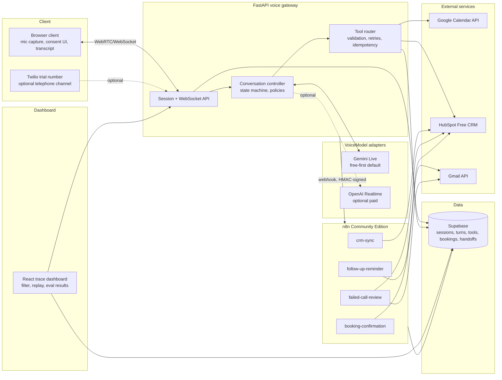

# Reference architecture

Figure 1 (blueprint §5): provider-adapter architecture — free browser mode
first, telephony and OpenAI optional.

## Component responsibilities (blueprint §5)

| Component | Responsibility |
|---|---|
| Browser client | Microphone capture, audio playback, consent UI, live transcript, reconnect controls |
| FastAPI voice gateway | Session auth, WebSocket handling, rate limits, redaction, model adapter lifecycle |
| Conversation controller | State machine, language detection, policy prompts, approved knowledge retrieval |
| Tool router | Pydantic schema validation, authorization, retries, timeouts, idempotency keys |
| n8n workflow layer | Post-call orchestration, visible/editable by a non-Python operator |
| Supabase | Structured sessions, audit events, metrics, deletion status; raw audio off by default |
| React dashboard | Filter calls, replay transcripts, inspect tool traces, display measured eval results |

## Why the split

Low-latency conversation control, deterministic validation, and safety
policy enforcement live in Python because they're on the critical path of a
live voice turn (blueprint §8). Everything after a session ends — emailing a
confirmation, syncing a CRM record, chasing a follow-up — is business
orchestration that should stay inspectable by a non-engineer, so it lives in
n8n as exported, importable JSON workflows instead of backend code.
